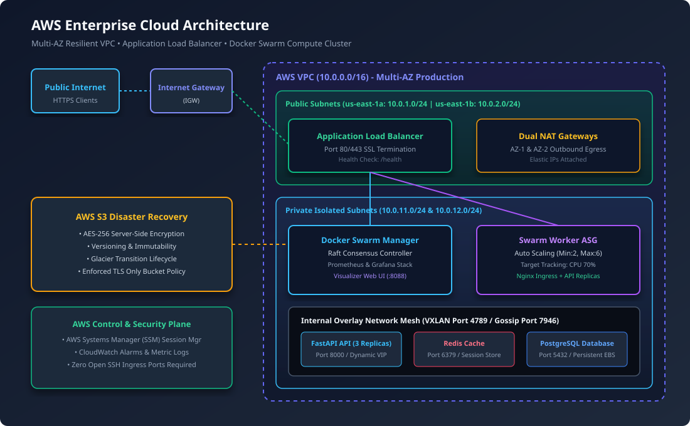
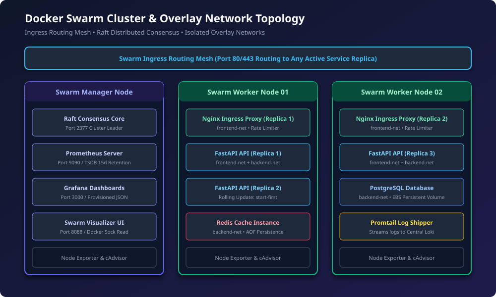
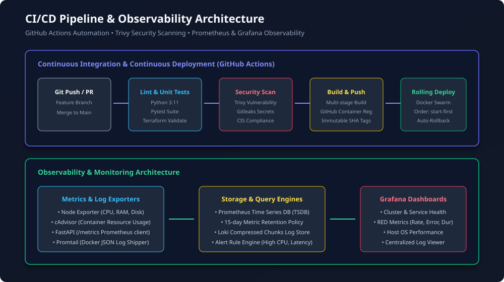

# Enterprise Cloud Infrastructure & DevOps Automation

[](https://github.com/shaikmohamed673-dev/enterprise-cloud-devops-automation/actions/workflows/terraform-ci.yml)
[](https://github.com/shaikmohamed673-dev/enterprise-cloud-devops-automation/actions/workflows/app-ci-cd.yml)
[](https://github.com/shaikmohamed673-dev/enterprise-cloud-devops-automation/actions/workflows/security-scan.yml)
[](terraform/)
[](docker-swarm/)
[](monitoring/)
[](LICENSE)

> **Cognevance Internship Project Submission**  
> **Project Title:** Enterprise Cloud Infrastructure & DevOps Automation  
> **Author:** Shaik Mohamed ([shaikmohamed673-dev](https://github.com/shaikmohamed673-dev))  
> **Email:** shaikmohamed673@gmail.com  
> **Submission Destination:** support@cognevance.online  

---

## 📌 Project Overview

This project delivers an enterprise-grade cloud infrastructure and automated DevOps lifecycle built on **Amazon Web Services (AWS)** using **Terraform (Infrastructure as Code)**, **Docker Swarm (Container Orchestration)**, and **Prometheus & Grafana (Observability)**.

The system is designed to provide:
- **High Availability & Fault Tolerance**: Multi-AZ AWS architecture spanning `us-east-1a` and `us-east-1b` with dual NAT Gateways and Application Load Balancer.
- **Automated Container Orchestration**: Docker Swarm cluster with ingress routing mesh, isolated overlay networks, and zero-downtime rolling updates.
- **Continuous Integration & Delivery (CI/CD)**: GitHub Actions automation testing Python services, running security scans (Trivy), building hardened Docker containers, and managing deployments.
- **Full-Stack Observability**: End-to-end monitoring using Prometheus, Grafana, cAdvisor, and Node Exporter with production alerting rules.
- **Security & Disaster Recovery**: Defense-in-depth security model, CIS OS hardening, automated encrypted database backups to S3, and sub-15 minute RTO.

---

## 🏗️ Architecture Diagrams

### 1. AWS Cloud Infrastructure Architecture


### 2. Docker Swarm Cluster & Overlay Network Topology


### 3. CI/CD & Observability Pipeline


---

## 🛠️ Project Tasks Breakdown & Deliverables

| Task # | Task Description | Deliverable / Implementation Reference | Status |
|:---:|:---|:---|:---:|
| **1** | **Scalable Cloud Architecture (AWS)** | Multi-AZ VPC (`10.0.0.0/16`), Public/Private subnets, Dual NAT Gateways, ALB. See [docs/ARCHITECTURE.md](docs/ARCHITECTURE.md) | ✅ Complete |
| **2** | **Infrastructure as Code (Terraform)** | Production & staging environments with reusable modules (`vpc`, `alb`, `compute_swarm`, `iam`, `s3_backups`, `security_groups`). See [terraform/](terraform/) | ✅ Complete |
| **3** | **Docker Swarm Cluster Orchestration** | Manager/Worker cluster bootstrap, Raft consensus, overlay networks (`frontend-net`, `backend-net`, `monitoring-net`), rolling updates. See [docker-swarm/](docker-swarm/) | ✅ Complete |
| **4** | **Automated CI/CD Workflows** | GitHub Actions pipelines for Terraform linting/validation, pytest unit testing, Trivy container security scans, and rolling deployment. See [.github/workflows/](.github/workflows/) | ✅ Complete |
| **5** | **Monitoring & Logging (Prometheus & Grafana)** | Prometheus metrics scraper, alerting rules (`alert.rules.yml`), pre-configured Grafana dashboards, cAdvisor, Node Exporter, and Loki. See [monitoring/](monitoring/) | ✅ Complete |
| **6** | **Security, Backups & Disaster Recovery** | CIS sysctl hardening (`harden-node.sh`), encrypted PostgreSQL backups to S3 (`backup-database.sh`), DR test suite, and runbook. See [docs/SECURITY.md](docs/SECURITY.md) & [docs/DISASTER_RECOVERY.md](docs/DISASTER_RECOVERY.md) | ✅ Complete |
| **7** | **Performance & Scalability Optimization** | EC2 Auto Scaling Target Tracking (CPU 70%), Nginx rate limiting and connection pooling, multi-stage image optimization. See [docs/PERFORMANCE_AND_SCALABILITY.md](docs/PERFORMANCE_AND_SCALABILITY.md) | ✅ Complete |
| **8** | **Comprehensive Architecture & Deployment Docs** | Production deployment guide, formal internship report, monitoring guide, and vector diagrams. See [docs/](docs/) | ✅ Complete |

---

## 📁 Repository Folder Structure

```text
enterprise-cloud-devops-automation/
├── .github/
│   └── workflows/
│       ├── terraform-ci.yml           # IaC format check, validate & Trivy security audit
│       ├── app-ci-cd.yml              # Microservice pytest, Docker build & rolling deploy
│       └── security-scan.yml          # Gitleaks credential scanning & dependency audit
├── app/
│   ├── src/
│   │   ├── app.py                     # Production Python FastAPI microservice with /metrics
│   │   └── requirements.txt
│   ├── tests/
│   │   └── test_app.py                # Automated pytest unit test suite
│   ├── Dockerfile                     # Multi-stage, non-root (UID 10001) hardened build
│   └── nginx/
│       └── nginx.conf                 # Hardened Nginx reverse proxy with rate limiting
├── docker-swarm/
│   ├── app-stack.yml                  # Production stack (Nginx, API, Redis, Postgres, Visualizer)
│   ├── monitoring-stack.yml           # Observability stack (Prometheus, Grafana, cAdvisor, Node Exp, Loki)
│   ├── init-swarm.sh                  # Swarm cluster initialization script
│   ├── join-worker.sh                 # Worker join automation script
│   └── deploy-stack.sh                # Zero-downtime stack deployment script
├── monitoring/
│   ├── prometheus/
│   │   ├── prometheus.yml             # Scrape configurations (15s interval)
│   │   └── alert.rules.yml            # Production alert rules (CPU, memory, downtime)
│   ├── grafana/
│   │   ├── provisioning/              # Auto-provisioned Prometheus & Loki datasources
│   │   └── dashboards/                # Pre-built JSON dashboards (Swarm & Host metrics)
│   └── loki/
│       ├── loki-config.yml            # Loki log storage configuration
│       └── promtail-config.yml        # Promtail log shipping configuration
├── security/
│   ├── harden-node.sh                 # CIS-aligned OS sysctl, UFW, and SSH hardening script
│   ├── docker-daemon.json             # Hardened Docker daemon (live-restore, no-new-privileges)
│   └── fail2ban/
│       └── jail.local                 # SSH & Nginx brute-force protection
├── scripts/
│   ├── backup/
│   │   ├── backup-database.sh         # AES-256 encrypted database backup pushed to S3
│   │   ├── backup-swarm-state.sh      # Swarm Raft log state backup script
│   │   └── restore-database.sh        # Disaster recovery restoration pipeline
│   ├── disaster-recovery/
│   │   └── dr-simulation-test.sh      # Automated DR resilience & self-healing test
│   └── setup-local-simulation.sh      # One-click local testing & simulation playground
├── terraform/
│   ├── environments/
│   │   ├── prod/                      # Multi-AZ Production environment root
│   │   └── staging/                   # Single-NAT Staging environment root
│   ├── modules/
│   │   ├── alb/                       # Application Load Balancer module
│   │   ├── compute_swarm/             # EC2 Manager, Worker Launch Template & ASG
│   │   ├── iam/                       # IAM roles for SSM and S3
│   │   ├── s3_backups/                # Encrypted, versioned S3 bucket with Glacier lifecycle
│   │   ├── security_groups/           # Layered firewall rules
│   │   └── vpc/                       # Multi-AZ networking (Public & Private subnets)
│   ├── versions.tf                    # Terraform & AWS provider constraints
│   └── README.md
├── docs/
│   ├── ARCHITECTURE.md                # In-depth architectural specification
│   ├── PROJECT_REPORT.md              # Formal internship project report
│   ├── DEPLOYMENT_GUIDE.md            # Step-by-step production deployment manual
│   ├── MONITORING_GUIDE.md            # PromQL queries, alerts, and dashboard guide
│   ├── SECURITY.md                    # Defense in depth, CIS baseline, and secrets
│   ├── DISASTER_RECOVERY.md           # RTO/RPO targets, failover, and DR runbook
│   ├── PERFORMANCE_AND_SCALABILITY.md # Autoscaling, caching, and cost optimizations
│   └── architecture/                  # High-resolution vector SVG diagrams
├── TEACH_ME/                          # Comprehensive student tutorial & viva guide
├── .gitignore
├── LICENSE
└── README.md
```

---

## ⚡ Quickstart: Local Hands-On Simulation

You can run and test the entire infrastructure and microservices stack locally without incurring cloud costs:

```bash
# 1. Initialize local Swarm mode & overlay networks
bash scripts/setup-local-simulation.sh

# 2. Deploy application and observability stacks
cd docker-swarm
./deploy-stack.sh
```

### Access Local Endpoints
| Service | URL | Credentials | Purpose |
|:---|:---|:---|:---|
| **Web API** | `http://localhost/` | None | Service metadata & node hostname |
| **Health Probe** | `http://localhost/health` | None | Application & database health check |
| **Prometheus UI** | `http://localhost:9090` | None | Time-series query interface & alerts |
| **Grafana Dashboards**| `http://localhost:3000` | `admin` / `admin_secure_cloud` | Pre-loaded cluster & node dashboards |
| **Swarm Visualizer** | `http://localhost:8088` | None | Live visual container placement graph |

---

## 🚀 AWS Cloud Deployment

To deploy directly to AWS using Terraform:

```bash
# 1. Navigate to production Terraform configuration
cd terraform/environments/prod

# 2. Configure variables
cp terraform.tfvars.example terraform.tfvars
# Edit terraform.tfvars with your region and office IP

# 3. Initialize, Plan & Apply
terraform init
terraform plan -out=prod.plan
terraform apply prod.plan

# 4. Retrieve ALB public URL
terraform output alb_dns_name
```

Refer to [docs/DEPLOYMENT_GUIDE.md](docs/DEPLOYMENT_GUIDE.md) for full instructions.

---

## 🧪 Verification & Self-Healing Testing

Simulate an unannounced container failure to test Docker Swarm self-healing:
```bash
bash scripts/disaster-recovery/dr-simulation-test.sh
```

Execute an automated encrypted database backup to AWS S3:
```bash
bash scripts/backup/backup-database.sh
```

---

## 📄 License
This project is licensed under the MIT License - see the [LICENSE](LICENSE) file for details.
